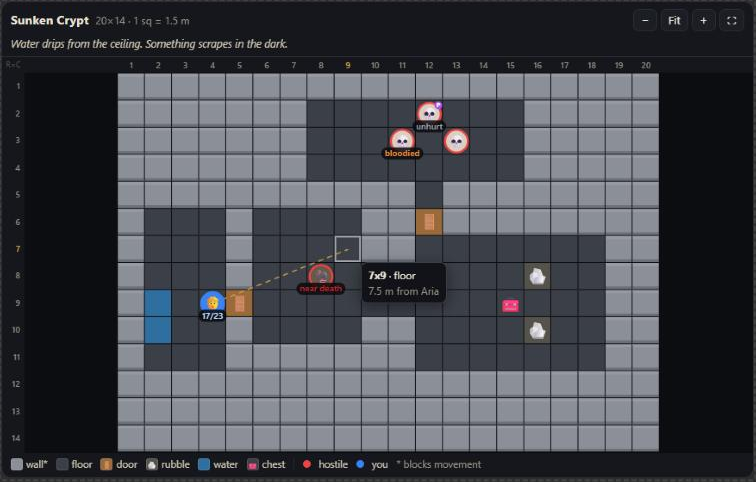
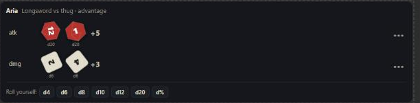
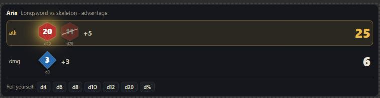

# D&D Tabletop for Claude

Claude runs your D&D game as Dungeon Master and gets a **grid battle map** and **animated dice** that show up right in the chat (Claude Desktop) or in a game page in your browser (Claude Code). Everything runs on your computer: no accounts, no API keys, no servers, no connectors. Your campaign notes and house rules are plain markdown files you can open and edit.

> **Two ways to play:** the Claude Desktop extension (`.mcpb`, cards in the chat) or the Claude Code plugin (a browser game page, [see below](#play-in-a-browser-page-with-claude-code)). Neither works in claude.ai in the browser or in the mobile apps, though the Claude Code game page can be opened on a phone on your Wi-Fi.






*Screenshots from the MCP Apps reference host (ext-apps basic-host). In Claude Desktop the cards appear inline in the conversation. A Claude Desktop screenshot still needs to be added here.*

---

## Install (3 steps)

1. Download `dnd-tabletop-<version>.mcpb` from the [latest release](https://github.com/bartooshe1/dnd-tabletop/releases/latest).
2. Double-click the file. Or, in Claude Desktop, open **Settings → Extensions → Advanced settings → Install Extension…** and pick the file.
3. Click **Install** and make sure **D&D Tabletop** is switched on.

Claude Desktop ships its own Node.js, so there is nothing else to install.

## Start playing

Open a new chat and say:

> Run a D&D campaign for me. Use the map, roll and notes tools.

Claude reads the house rules and your campaign notes once at the start, then narrates, draws the scene and rolls dice. Click any square on the map to put what you want to do into the chat, for example "I move to 4x8." You can edit the text before you send it. The map never moves your character by itself; Claude moves it after you say what you do.

## Play in a browser page with Claude Code

The same engine also runs as a **Claude Code plugin**. Claude is the DM in your terminal, and you play in a game page in your browser: chat with the DM, a dice tray, the battle map, your character sheet and a journal.

**You need** [Claude Code](https://docs.claude.com/en/docs/claude-code) on Windows, macOS or Linux, with Node.js 20 or newer.

**Install** (two commands in a terminal):

```bash
claude plugin marketplace add bartooshe1/dnd-tabletop
```

```bash
claude plugin install dnd-tabletop@dnd-tabletop
```

**Play:** start `claude` in any folder and type `/startdnd` (or `/startdnd The Sunken Crown` to give it a title). The game page opens in your browser. Next time, type `/continuednd` to carry on. Stop by pressing **Save & pause** on the page.

What the game page has:

- **Story chat** with a typewriter effect. Click a map square to add it to what you type (`4x8`). **A− / A+** changes the text size.
- **Dice tray** (d4 to d100). Your rolls are real and go along with your next message. DM rolls animate too.
- **Battle map** with textured terrain, shimmering water, flickering fire and a **turn-order strip** in combat. The token whose turn it is gets a gold ring.
- **Character sheet** (stats, attacks, features, inventory) with an **XP bar**. When you have enough XP, a **Level up!** button opens a guide: roll or take average HP, pick an ability increase or feat, subclass and spells, then send it all to the DM.
- **Journal** tab: quests, people you've met, places and lore, and the story so far.
- **Condition help:** hover over or tap "prone", "poisoned" and so on to see what it does.
- **Resizable layout:** drag the bars between chat, rolls, map and sheet.
- **Settings (⚙):**
  - **Sound** (off by default): dice and a your-turn chime, plus background sounds (rain, cave, tavern, forest, campfire, sea, wind, or "match the scene"). All sounds are made in code; nothing is downloaded.
  - **Tell me when it's my turn:** a notification when the tab is in the background.
  - **Storybook:** your whole adventure as one book-style HTML file to read, print or share.
  - **Campaigns:** your other saved adventures.
  - **Play from a phone:** a LAN mode with a QR code.

**Several campaigns:** `/startdnd` saves the current campaign before starting a new one. To go back to one, type `/continuednd` with its name, for example `/continuednd The Sunken Crown`; the one you were playing is saved first. Settings → Campaigns lists them.

**Spoiler warning:** the terminal shows Claude's tool calls, including DM notes and hidden rolls. Keep your eyes on the game page.

Troubleshooting:
- **"This link is from an earlier session":** open the newest link Claude printed, or run `/continuednd` again.
- **The page says the DM is thinking for a long time:** look at the terminal. If Claude stopped, type `/continuednd`.
- **Two games at once:** only one front end can run a campaign at a time. Close other Claude Code windows that run the game, or the Claude Desktop extension, then try again.

---

## The four tools

| Tool | What it does |
|---|---|
| `map(commands)` | Edits the map using a small command language (below). Silent: it returns `ok` plus only what Claude can't know (new token ids, generator room list). |
| `show_map(tokens?)` | Shows the map card in the chat. `tokens:true` also gives Claude a token list with real HP (DM screen). |
| `roll(dice, label?, roller?, mode?, secret?)` | Rolls dice with `crypto.randomInt` and shows the animated dice card. Claude never supplies numbers. |
| `notes(op?, file?, section?, text?)` | Reads and writes sections of `campaign.md` and `house_rules.md`. |

Why two map tools: MCP Apps attaches a card to a tool, not to a single call, so `map` can't show a card only some of the time. Claude edits with `map`, then calls `show_map` to display it. See [Decisions](#decisions).

## What you see on the cards

**Map card:** dark grid with row numbers down the left and column numbers along the top, so "4x8" is easy to find. Terrain is drawn in code with textures (brick walls, flagstones, wooden planks, grass, cobbles, water that shimmers and fire that flickers) plus small icons, and tokens sit on top. In combat a **turn order** strip shows everyone's initiative and whose turn it is, and that token gets a pulsing gold ring. **Your character shows HP numbers. Everyone else shows only a wound word** (unhurt, hurt, bloodied, badly wounded, near death, down). Hover a square to see what's there and how far it is from you in meters. Use −, +, Fit, Ctrl/⌘ + scroll or pinch to zoom, drag to pan, and ⛶ to expand when Claude Desktop offers full screen. When a newer map card appears, older ones are marked "older view" and stop sending.

**Dice card:** each die tumbles for about 1.3 s, then lands on the real server value. Advantage and disadvantage show both d20s with the dropped one crossed out. A natural 20 glows gold; a natural 1 shakes red. Turn on "reduce motion" in your OS and the dice settle at once. If Claude Desktop allows cards to call tools, a small tray lets you roll a die yourself and then **Say it in chat**. Secret DM rolls show nothing at all.

---

## Map command language

One `map` call takes many commands separated by `,` `;` or new lines. Case and extra spaces don't matter. **A batch is atomic:** if any command fails, nothing is applied and Claude gets every error with its number, the reason and a suggestion.

**Cells** are `RxC`: row then column, starting at `1x1` in the top-left. A range `RxC..RxC` is a filled rectangle. **Map sizes** are `WxH` (columns × rows), like screen sizes.

| Command | Meaning |
|---|---|
| `1x1..1x4-wall` | Set terrain on a cell or range |
| `4x3-player`, `5x5-wolf` | Place a creature token. A bare type gets an id: `wolf1`, `wolf2`… `player` reuses your existing `player1` (HP follows you between scenes). Any name works, e.g. `5x5-beholder` |
| `5x5..5x7-skeleton` | One token per cell (`skeleton1`–`skeleton3`) |
| `4x3 > 4x8`, `player1 > 4x8` | Move a token. Fails if the target has a token or blocking terrain |
| `wolf1 >! 4x8` | Force a move onto blocking terrain (never onto a token) |
| `3x3-empty` | Remove the token there; if there is none, reset the terrain |
| `3x3-clear` | Remove token and terrain |
| `new "Crypt" 16x12`, `use "Crypt"`, `maps` | Scenes: create (and switch to), switch, list |
| `caption Rain on the shutters` | Caption bar on the card |
| `scale 1.5` | Meters per square (feet if you chose imperial). Default 1.5 m (combat); 3 m is a good exploring scale |
| `tok wolf1 name=Snik hp=7/11 status=prone,poisoned side=ally` | Token details. `hp=-3`/`hp=+4` change HP and report the new value; `status=+prone`, `status=-prone`, `status=none` |
| `type wetfloor glyph=💧 color=#4a6 blocking`, `types` | Define a terrain type (kept for the campaign); list all types |
| `draw` + ASCII rows | Draw the whole map (see below) |
| `load tavern`, `load tavern at 3x3`, `rooms` | Premade rooms (replace the map, or embed at an offset); list rooms |
| `save "The Midnight Inn"` / `… with tokens` | Save the current map as a room you can `load` later |
| `gen dungeon 20x14 rooms=4 seed=42` | Generate a map (see below) |
| `init player1=17 wolf1=12`, `init next`, `init -wolf1`, `init end` | Combat turn order: set or update initiative totals (highest goes first), pass the turn (rounds count up), drop one, end the fight |

`4x3 > 4x8` and `4x3-empty, 4x8-player1` give exactly the same result. Tokens removed in a batch keep their stats until the batch ends.

**Terrain types** (`*` blocks movement): floor, wall\*, door, door_locked\*, window\*, water, deep_water, lava, grass, tree\*, bush, road, stairs_up, stairs_down, ladder, chest, trap, table, chair, bed, bar\*, fire, rubble, pillar\*, fence\*, market_stall\*, barrel\*, altar\*, crate\*, rug, statue\*, bookshelf\*, well\*. Common other names work too (`stone_wall`, `wet_floor`, `door_open`, `campfire`, `carpet`, `barrels`, …). An unknown name that looks like terrain gets an error with the closest matches and how to define it:

```
unknown terrain 'wetfloor', closest: floor (to add: type wetfloor glyph=💧 color=#4a6; for a creature named that, write wetfloor!)
```

**Creatures**: `data/creatures.json` has 268 SRD 5.1 monsters and common NPC roles with an emoji and color. NPC roles (barkeep, guard, merchant, …) start as neutral; other creatures start hostile. Names not in the list still work and show as a colored circle with their first two letters.

**Drawing** a map from ASCII:

```
draw ~=water T=table w=wolf
#########
#..T....#
#.@..~~.+
#....w..#
#########
```

The default legend is `#` wall, `.` floor, `+` door, `@` player and space for nothing. Add more on the `draw` line or on the line after it. Rows end at the first blank line.

## Rooms, layouts and generators

Built-in rooms (`rooms` lists them, size is WxH at 1.5 m per square):

| Room | Size | |
|---|---|---|
| tavern | 14x10 | common room with bar, kitchen, hearth, tables, stairs up |
| cellar | 10x8 | barrels, crates, stairs up |
| small_chamber | 7x7 | bare stone room, two doors |
| crypt | 12x10 | pillars, sarcophagi, statues, stairs up |
| prison_cells | 14x9 | corridor, 7 locked cells, guard room |
| market_square | 18x14 | stalls, crates, a well, four exits |
| forest_clearing | 14x12 | path, pond, fallen log |
| cave_chamber | 14x11 | pool, rubble, two tunnels |
| smithy | 10x8 | forge, anvils, front and back door |
| temple | 14x12 | pews, pillars, rug, altar, statues |
| alley | 16x6 | crates, barrels, side doors |
| throne_room | 16x12 | thrones, pillars, long rug |

`save "Name"` stores your own rooms in the campaign folder (`rooms/<name>.json`) and adds the name to the "Saved rooms" section of `campaign.md`. `load midnight inn` finds it by a loose name. Saving again under the same name replaces it.

Generators are deterministic from `seed` (a random seed is reported if you don't give one), always connected and playable, and at least 5x5:

| Command | Options | Returns |
|---|---|---|
| `gen dungeon 20x14` | `rooms=4 doors=true seed=` | `r1 center 9x3 3x6; r2 …; doors 6x12,9x5` |
| `gen cave 30x20` | `fill=45 entrance=true rubble=true seed=` | `entrance 2x1; open spots 15x23,…` |
| `gen clearing 14x14` | `path=true seed=` | `clearing center 8x8; path ends 8x1,8x14` |
| `gen street 20x8` | `seed=` | `road rows 4-5; doors 3x5,3x9,…` |

Room centers are cells (RxC); the size after them is WxH. Claude uses these to place creatures in the next call.

## Dice

`roll` takes `NdM±K` with d4, d6, d8, d10, d12, d20 and d100. Several rolls, labels and repeats go in one call:

```
1d20+5 atk, 2d6+1d4+3 dmg, 4*(1d20+2) init
```

Limits: up to 20 dice per group, modifiers within ±100, up to 20 rolls per call. `mode: "adv"` or `"dis"` rolls two d20s for each `1d20` group and keeps the higher or lower. Results look like `atk 1d20+5: [14]+5 = 19`, with `NAT 20` / `NAT 1` noted.

`secret: true` is for hidden DM rolls (NPC behavior). They show no card and no animation, and they are left out of the visible roll history (the last 200 rolls). One caveat: Claude Desktop lets you expand any tool call to see its raw result, and that includes secret rolls. Don't peek.

---

## Your files: notes and house rules

Everything lives in one folder:

| OS | Folder |
|---|---|
| Windows | `%APPDATA%\dnd-tabletop` |
| macOS | `~/Library/Application Support/dnd-tabletop` |
| Linux | `$XDG_DATA_HOME/dnd-tabletop` or `~/.local/share/dnd-tabletop` |

You can pick another folder in the extension's settings.

- `campaign.md`: sections **Current State, Character, Inventory, Story Log, NPCs, Quests, World Notes, Saved rooms**. Claude reads "Current State" by default and the whole file once per session. It replaces (`write`) or adds to (`append`) a section right after HP, XP, money, items, spell slots or quests change. You can edit the file yourself; keep the `## ` headings.
- `house_rules.md`: how Claude runs your table (5e by the book, no hidden information, real dice, wound words only for enemies, the DM never plays your turn, no steering, short replies). Add your own rules under **Player notes**. Claude reads it once at the start of a session. Ask it to re-read after you change it.
- `campaign.json`: map state (scenes, tokens, custom terrain, roll history). It is written atomically with a `.bak` copy. If it gets damaged, the bad file is kept aside and the last good state is restored.
- `rooms/`: your saved rooms.
- Claude Code mode also keeps `chat.json` (the page's chat), `sessions/` (a short log of every session), `transcripts/` (the full story text, if turned on), `campaigns/` (your other saved campaigns), `storybooks/` (books you made) and `archive/` (a safety copy each time you start a new campaign). The sections **DM Secrets** and **Current State** never reach the game page.

**Start a fresh campaign:** quit Claude Desktop and move or rename the folder (or choose a new folder in the extension settings). New files are created on the next start. There is one campaign per folder.

## Settings

In **Settings → Extensions → D&D Tabletop**:

| Setting | Values | |
|---|---|---|
| Tool result detail | `lean` (default) or `detailed` | detailed adds things like move distances (`player1 1x1→4x5 6 m`) |
| Units | `metric` (default) or `imperial` | imperial shows feet (1.5 m = 5 ft) |
| Campaign folder | any folder | optional, see above |

---

## Token use

Token use was designed in, without cutting game quality. Measured with `npm run measure` (characters ÷ 4):

| Every turn | ≈ tokens |
|---|---|
| tool `map` (grammar + 3 examples) | 350 |
| tool `show_map` | 78 |
| tool `roll` | 121 |
| tool `notes` | 136 |
| **tool list total** | **686** |
| server instructions (86 words) | 124 |
| **fixed per-turn total** (CI fails above 1,200) | **810** |

| Typical results | ≈ tokens |
|---|---|
| `map` with 20 commands | 51 |
| `map` batch with 3 errors | 87 |
| `show_map` (card shown) | 8 |
| `show_map tokens:true` (state for Claude) | 34 |
| `gen dungeon 20x14 rooms=4` | 27 |
| `roll` attack + damage | 11 |
| `notes` read Current State | 30 |
| `notes` read whole new campaign.md | 223 |
| `notes` read house rules (once per session) | 535 |
| `notes` append | 1 |

The card data travels in the result's `_meta`, which MCP Apps reserves for the UI, so the map grid never enters Claude's context.

Tips:
- Start a **fresh chat for each session**. Claude re-reads the rules and notes and the old turns stop costing tokens.
- **Turn off connectors and extensions you aren't using** during play; every tool list costs tokens every turn.
- **Keep maps room-sized** and load the next room when you get there. That also keeps the map to what your character knows.
- Ask Claude to **batch all map changes for a turn into one call**.
- Keep **lean** results unless you want the extra detail.

## Troubleshooting

- **No card appears, only text.** Update Claude Desktop, check that the extension is enabled, then fully quit Claude Desktop (not just close the window) and reopen it; it caches the cards. Start a new chat.
- **Claude prints an ASCII map.** Claude Desktop didn't report MCP Apps support, so the server sent its text fallback. Update Claude Desktop.
- **"Couldn't send from the card."** Claude Desktop refused the card's message. Type the same thing in the chat.
- **The dice tray is missing.** It only shows when Claude Desktop lets cards call tools.
- **Something looks wrong with the campaign.** Open the folder above. `campaign.md` and `house_rules.md` are plain text, and `campaign.json.bak` holds the previous map state. The extension's log is in Claude Desktop's logs folder (`mcp-server-D&D Tabletop.log` or similar).

## Development

```bash
npm ci
```

```bash
npm test
```

```bash
npm run build
```

Development needs Node 22 or newer (for `node --test` globs); the extension itself runs on the Node that Claude Desktop ships.

`npm test` bundles the cards and runs all tests (`node:test`): parser, executor, layouts, generators, wounds and HP privacy, dice, notes, persistence, a stdio integration test of all 4 tools, and the token budget. `npm run build` writes `dist/dnd-tabletop-<version>.mcpb` (it bundles the two cards into single HTML files with esbuild, stages a clean folder with production dependencies only, then runs `mcpb validate` and `mcpb pack`).

Other scripts:
- `node scripts/smoke-mcpb.mjs dist/dnd-tabletop-0.1.0.mcpb <tmpdir>` unpacks a built bundle and drives it over stdio like a host.
- `node scripts/dev-http-bridge.mjs 3001 server/index.js <dataDir>` (dev only, never shipped) exposes the stdio server over HTTP so the [ext-apps basic-host](https://github.com/modelcontextprotocol/ext-apps/tree/main/examples/basic-host) can render the cards in a browser.
- `node scripts/make-icon.mjs` regenerates `icon.png`.
- `spike/` is the first 5x5 test bundle. Its card prints what the host supports, which helps when debugging a new Claude Desktop version (`node spike/build.mjs`).

**Release:** bump `version` in both `package.json` and `manifest.json`, commit, then tag and push:

```bash
git tag v0.1.0
```

```bash
git push origin v0.1.0
```

The GitHub Actions workflow runs the tests on Windows, macOS and Linux, builds the `.mcpb`, smoke-tests the packed file and attaches it to a GitHub Release.

Layout: `manifest.json`, `icon.png`, `docs/` (screenshots), `server/` (stdio MCP server; `lib/` holds the pure parser, executor, generators, dice and notes modules), `ui/` (map and dice card sources), `data/creatures.json`, `layouts/`, `templates/` (`campaign.md`, `house_rules.md`), `test/`, `scripts/`, `.github/workflows/release.yml`.

---

## Decisions

Choices made where the brief left room, with the reason:

1. **MCP Apps can't attach a card to only some calls.** A tool either declares a `ui://` resource or doesn't (spec 2026-01-26, "Resource Discovery"). So `map` is silent and `show_map` renders, which takes two calls when a scene changes. House rule 9 says "call `map` …, then `show_map`".
2. **Card data goes in `_meta`, not `structuredContent`.** The spec calls `_meta` "not intended for model context" and maps OpenAI's widget-only metadata to it, while some hosts pass `structuredContent` to the model. The key is `_meta["dnd-tabletop/view"]`. The spike checks that Claude Desktop delivers it.
3. **ext-apps 1.7.5 with `@modelcontextprotocol/sdk` 1.x.** ext-apps 2.x needs the split `@modelcontextprotocol/server`/`client` packages, which are outside the allowed dependencies. The iframe wire protocol is identical in both. Tools use both `_meta.ui.resourceUri` and the legacy `_meta["ui/resourceUri"]` (the helper writes both).
4. **UI metadata is always attached.** Capability detection only decides how verbose `show_map` is. A host that advertises `io.modelcontextprotocol/ui` gets one short line; any other host gets the full ASCII map with rulers, legend and wound words. The reference basic-host doesn't advertise the capability but renders cards anyway, so gating the cards on it would break rendering.
5. **Secret rolls.** The `roll` card can't be switched off per call, so for `secret: true` the card hides itself as soon as it sees the tool input, and the result's `_meta` holds no numbers. The result text (for Claude) is still visible if you expand the tool call.
6. **Cells are RxC, sizes are WxH**, as specified. The card's rulers, the tool description and every error message spell this out (`map is 16x12 W×H: rows 1-12, cols 1-16`).
7. **New maps are floor.** `-empty` on a cell without a token resets terrain to the map's base (floor; grass for clearings; road for streets). `-clear` leaves nothing (void).
8. **Tokens live at campaign level** so the player keeps HP and conditions between scenes. A bare `player` reuses a player token that isn't on this map; allies are reused the same way. When hostile and neutral tokens leave the board they are deleted, but only at the end of the batch, which is what makes remove-and-place equal to a move.
9. **Placing a token on blocking terrain is allowed** (a ghost in a wall, an owl in a tree) and the result adds a short note. *Moving* onto blocking terrain needs `>!`.
10. **Unknown terrain vs open creature names.** Any name that isn't terrain is a creature, unless it looks like a misspelled terrain (`wetfloor`, `stonewal`). Then it's an error with suggestions, and a trailing `!` forces a creature.
11. **Wound words** add **"down"** at 0 HP. Tokens with no HP set show no wound word. NPC roles in the creature list (barkeep, guard, merchant…) start neutral.
12. **HP shortcuts:** `hp=-3` and `hp=+4` are relative and clamp between 0 and max, and the result reports the new value. `hp=7` alone sets both current and max the first time.
13. **Distances** use the 5e default: a diagonal counts as one square. Imperial uses the D&D convention 1.5 m = 5 ft; state is stored in meters.
14. **Commas in values:** after `caption`, and inside a `tok`/`type` value list (`status=prone,poisoned`), a comma piece that isn't a valid command stays part of that command. Quote text to be safe: `caption "A, B; C"`.
15. **The `draw` default legend is only `# . + @` and space**, so a forgotten legend entry gives an error instead of a wrong guess. Built-in layouts use every terrain type's own character.
16. **The click intent text** is "I move to 4x8." on an empty square and "<Name> at 5x5: " on a token. It's editable and nothing is sent until you press **Say it in chat**.
17. **Older map cards go inert.** Each card announces the server time of its data on a `BroadcastChannel`, and older cards show "older view" and won't send intents. If a sandbox has no `BroadcastChannel`, this silently does nothing.
18. **Plain mouse-wheel scrolling scrolls the chat**, not the map. Zoom with Ctrl/⌘ + wheel, pinch, or the buttons. In full screen the wheel zooms.
19. **MCPB `user_config` has no dropdown type** (manifest 0.3), so `detail` and `units` are text fields. The server accepts the documented values and falls back to the defaults otherwise.
20. **One campaign per folder** in v1. A damaged `campaign.json` is set aside, never deleted.
21. **Saved room names can't reuse a built-in name** (`save "Tavern"` is refused) so built-ins stay read-only.
22. **Dice:** several dice groups per expression (`1d8+2d6+3`) are allowed for sneak attacks and smites. d100 is one die from 1 to 100. The card shows up to 5 earlier rolls.
23. **House rules** use "they" for the player and add "then `show_map`" to rule 9. When Claude reads the rules, `<!-- comments -->` are removed, so the commented examples under "Player notes" are never taken as rules (it also saves about 100 tokens).
24. **Initiative is a `map` command, not a fifth tool.** Claude rolls initiative with `roll`, then `init player1=17 wolf1=12` shows the order. It is campaign state (it survives restarts), tokens that leave the map leave the order, a creature added mid-fight doesn't take the current turn, and the strip uses the same privacy as the map: wound words for everyone but you. Costs about 30 tokens per turn in the tool list.
25. **Map art is procedural.** Tiles are painted on small offscreen canvases once per terrain style, color, variant and zoom level and then reused, so a 60×60 map stays fast. Custom terrain types get a style guessed from their name (`mossy_stone` → stone, `swamp` → water). Water, lava, fire and the turn glow animate at about 14 fps, only while the map is on screen, never on older map cards, and not at all with "reduce motion".
26. **The game page's Journal tab** (Claude Code mode) shows Quests, NPCs, World Notes and Story Log from campaign.md. The page server whitelists those sections plus Character and Inventory; DM Secrets and Current State never reach the page. A rule tells Claude to keep anything the character doesn't know in DM Secrets. Older `house_rules.md` files get the new Claude Code rules added when read (the player's own lines stay).
27. **Text size** (A− / A+ in the header, or Settings) scales the chat and the side panel from 90% to 200%. It's remembered per browser, so a phone and a laptop can differ.
28. **Window sizes** on the game page: drag the bar under the chat, the bar under the rolls, or the sheet's left edge (arrow keys work too when a bar has focus). Double-click a bar, or use Settings → Window sizes → Reset, to go back to the default. The map takes whatever room is left and always keeps at least 150 px; sizes are remembered per browser.
29. **Several campaigns without a sixth tool.** The active campaign stays in the data folder itself (so nothing else had to change) and the others wait in `campaigns/<name>/`. `notes op=resume` with a name switches: the active one is copied onto the shelf first, then the chosen one is copied down, so a switch never deletes anything. Old `archive/` copies can be resumed too. Two campaigns may share a title; only a copy of the same campaign (same start time) is replaced. Each campaign now keeps the list of its own session logs, so "last session" lines and the storybook never mix campaigns.
30. **The storybook is built from player-facing text only:** the whitelisted notes sections and the transcripts (or the chat if transcripts are off), with all text HTML-escaped. It is a single self-contained file that is also saved in `storybooks/`.
31. **The level-up guide changes nothing by itself.** It reads XP and level from the Character section, rolls the hit die through the dice tray and sends your choices to the DM as a normal message, so the DM still applies the rules and updates the sheet.
32. **Sounds are synthesized** with Web Audio (noise, filters and oscillators), so there are no audio files and no network requests. They are off by default and remembered per device. Browsers only allow sound after a click, so background sound starts on your first click on the page.
33. **Turn notifications** use the browser's Notification API, which needs a secure page: they work with the `127.0.0.1` link, and on a phone over LAN only the tab title flashes.


### Manual check in Claude Desktop

1. Install the `.mcpb`, enable it, fully restart Claude Desktop.
2. New chat: "Run a D&D campaign; use the map, roll and notes tools." Claude should call `notes` (rules, then the whole campaign) once.
3. Ask for a tavern scene. You should see `map` followed by `show_map`, and an inline map card with rulers and your token.
4. Hover a square: the tooltip shows its contents and the distance in meters. Click a square and press **Say it in chat**; "I move to RxC." should appear as your message.
5. Try ⛶ (expand) and Fit / + / −.
6. Get into a fight: enemy tokens show wound words only; your token shows HP numbers.
7. Ask for an attack roll: the dice tumble and land on the number in Claude's reply. Ask for one with advantage.
8. Check that Claude's hidden rolls (`secret: true`) show no card.
9. Ask Claude to save the room, then look in the campaign folder: `rooms/…json` exists and `campaign.md` lists it under "Saved rooms".
10. Quit and reopen Claude Desktop, start a new chat, ask "where am I?". The map and notes should still be there.
